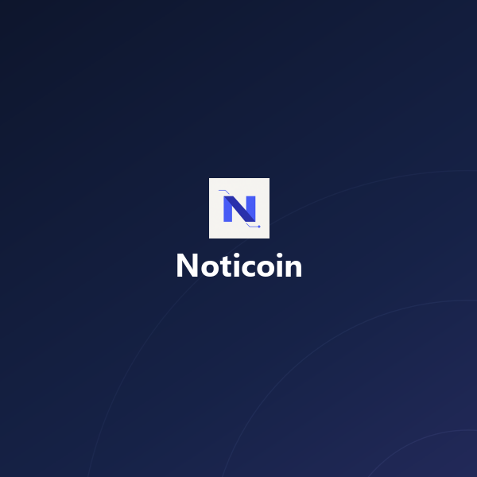

# Noticoin Wallet

Noticoin's desktop wallet for Linux and Windows. Send and receive Noticoin, manage addresses, and explore or publish notes on the built-in map.

[Official website](https://noticoin.com/) · [Blockchain and command-line wallet](https://github.com/noticoin-support/noticoin) · [Wallet guide](https://noticoin.com/wallets)

## Build on Ubuntu 24.04

```sh
sudo apt update
sudo apt install build-essential cmake ninja-build pkg-config libssl-dev \
  qt6-base-dev qt6-webengine-dev qt6-webchannel-dev libsecret-1-dev

cmake -S qt -B build -G Ninja -DCMAKE_BUILD_TYPE=Release
cmake --build build --target Noticoin-Wallet --parallel
```

For a local run, have Node.js 24 or newer and a desktop Secret Service keyring. Build the blockchain repository in a sibling `noticoin` directory, then run these commands from the wallet checkout.

```sh
mkdir -p build/bin build/qt
cp ../noticoin/build/bin/noticoind ../noticoin/build/bin/noticoin-wallet-rpc build/bin/
cp "$(command -v node)" build/bin/node
cp -R map build/
cp qt/i18n.*.json build/qt/
./build/Noticoin-Wallet
```

## Build on Windows x64

Run these commands in the MSYS2 UCRT64 shell.

```sh
pacman -S --needed mingw-w64-ucrt-x86_64-{gcc,cmake,ninja,qt6-base,openssl}

cmake -S qt -B build -G Ninja -DCMAKE_BUILD_TYPE=Release
cmake --build build --target Noticoin-Wallet --parallel
```

Install the [Microsoft Edge WebView2 Evergreen Runtime](https://developer.microsoft.com/en-us/microsoft-edge/webview2/#download). Obtain the x64 `WebView2Loader.dll` from the [Microsoft WebView2 SDK](https://www.nuget.org/packages/Microsoft.Web.WebView2) in `runtimes/win-x64/native/`. Assemble the same layout as on Linux, using `node.exe`, `noticoind.exe`, and `noticoin-wallet-rpc.exe` in `build/bin/` and the loader in `build/runtime/`. Launch `build/Noticoin-Wallet.exe` from the UCRT64 shell.
